
<picture>
  <source media="(prefers-color-scheme: dark)" srcset="web/brand/barnes-wordmark.png">
  
</picture>

# Barnes Television Broadcasting Service 📺

**Turn your Jellyfin library into 24/7 cable TV.**

Barnes Television Broadcasting Service (BTBS) runs next to Jellyfin and turns your movies and shows into real,
always-on TV channels: Saturday morning cartoons, a sitcom channel, Japanese TV, a movie channel, whatever you like.
Every channel has a real schedule, so when you tune in you land in the middle of whatever is "on", complete with
commercial breaks, station bumpers, a channel logo in the corner and a scrolling guide channel like the old cable boxes.

Watch in **Jellyfin's Live TV** on any Jellyfin app, in a **browser**, on a **Chromecast** with your phone as the
remote, or with the **Google TV / Android TV app** and your TV remote. It runs on **Windows and Linux** and can use the
ffmpeg that already comes with Jellyfin.

<b><a href="GUIDE.md">📖 Read the User Guide</a></b> · <a href="#quick-start">Quick start</a> · <a href="#screenshots">Screenshots</a>

---

## Highlights

**📅 Real TV scheduling**
- Unlimited channels built from any mix of libraries, genres, collections, shows, playlists, tags or networks, with
  anything you want left out.
- **YouTube too**: add a video, a playlist or a whole YouTube channel to any channel. It streams straight from
  YouTube, with no downloads and no YouTube ads.
- Shuffle, classic reruns, in order or pure random, and the same show never airs twice in a row.
- Programs start on the hour or half hour if you like, with filler and "Up Next" cards in the gaps.
- **Time slots** put a show on at set times ("The Simpsons, weeknights at 8"), picking up with the next episode.
- **Marathons** run one show back to back for up to 24 hours.
- **Airtime balancing** keeps a 300-episode show from drowning out a 10-episode one, with a pie chart of what each
  channel is made of.

**📢 Commercials and bumpers**
- Shows pause for commercial breaks from your own ad library and pick up at the exact frame they left off, snapping to
  chapter marks for natural act breaks.
- Drop in hour-long commercial compilations as they are: the separate ads are found automatically.
- 60+ built-in bumpers in a deadpan late-night style ("and now, back to {show}."), some that quote the local weather,
  plus your own text or video bumpers.

**📺 On screen**
- A channel logo ("bug") and a clock in any corner, with one-click styles from Japanese broadcast to VCR 7-segment.
- An "Up next" banner, burned-in subtitles, per-channel audio language and loudness leveling.
- A **guide channel** with a scrolling grid of every channel and a "Now On" spotlight.
- A **weather channel** with current conditions, forecasts, radar loops you can zoom in or out, future radar and
  severe weather alerts.
- Sleep channels that turn the screen black while the sound plays on.

**📡 Watch anywhere**
- Jellyfin Live TV with a full program guide (M3U + XMLTV), or HDHomeRun emulation for Plex, Emby and Channels DVR.
- A browser TV with channel surfing, a guide and static between channels.
- Chromecast casting with a phone remote, and a TV app for Google TV / Android TV.
- A channel lock with kids channels that stay watchable.

**🎨 Make it yours**
- 13 station themes, from Retro Cable to Synthwave to Teletext, plus a theme builder.
- 22 bundled fonts, or bring your own.
- Rebrand the whole station with your own name and logos, all the way into the TV app.

**⚡ Runs light**
- A channel only encodes while someone watches, and viewers share one stream.
- Hardware encoding with NVENC, QSV, AMF, VAAPI or VideoToolbox, or CPU encoding anywhere.
- Saving changes is instant, and startup never waits on your library.

---

## Screenshots

 
<b>The guide channel</b>: a scrolling, cable-style listing of every channel with a "now on" spotlight.

| | |
|---|---|
| 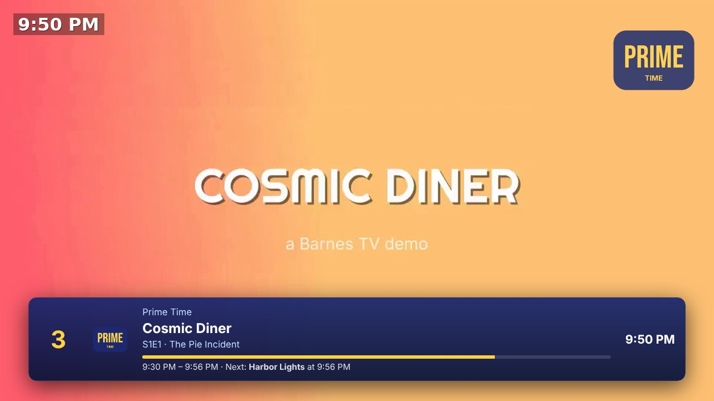 <b>Watching</b> in a browser or the TV app: channel bug, clock and the now/next banner. | 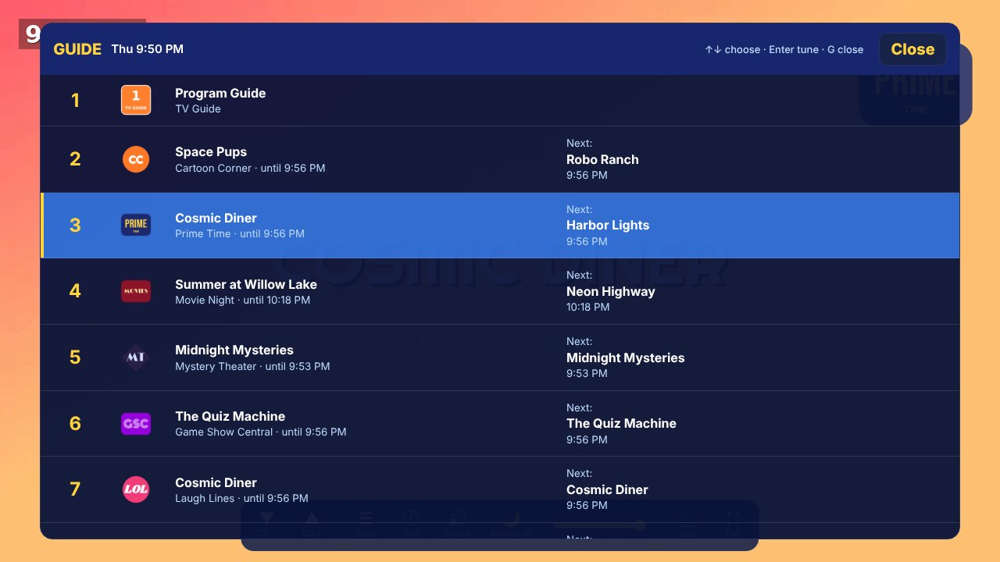 <b>The on-screen guide</b>: what's on now and next on every channel, driven by the TV remote. |
|  <b>The weather channel</b>: local radar looping over a street map, with a crawl along the bottom. |  Current conditions, the next 12 hours, a 7-day forecast, sun &amp; moon and weather alerts. |
|  <b>Future radar</b> (US): the next three hours of forecast radar. |  <b>"Up Next" cards and bumpers</b> between shows and around commercial breaks. |

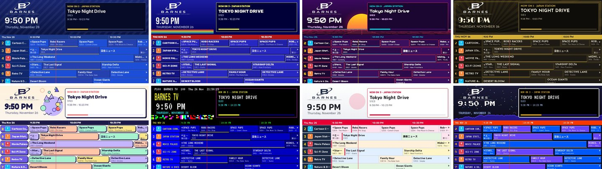 
<b>Themes</b>: the same guide in eight of the built-in looks. Or build your own.

**Admin page**

| | |
|---|---|
| 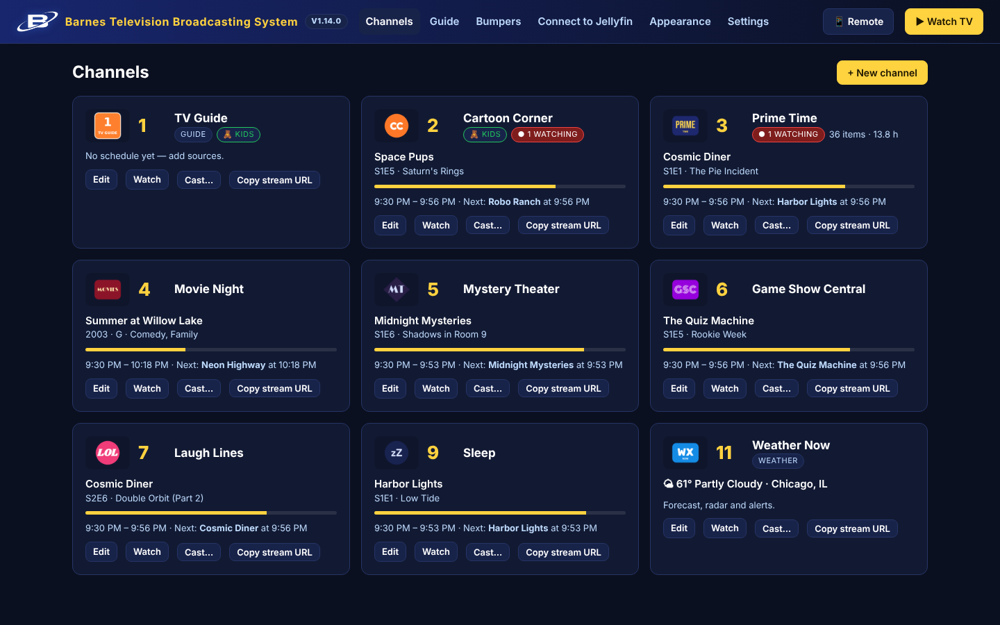 Every channel at a glance, with what's on now. | 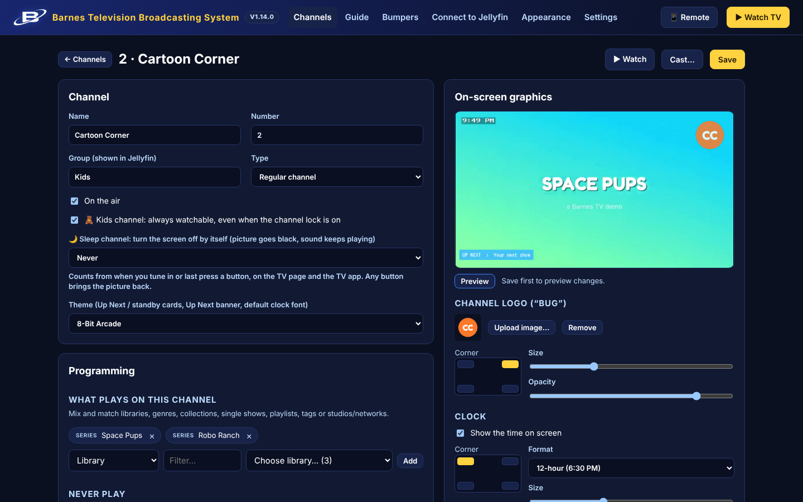 Editing a channel: Appearance, Scheduling, Commercials and Bumpers tabs, with a live preview. |
| 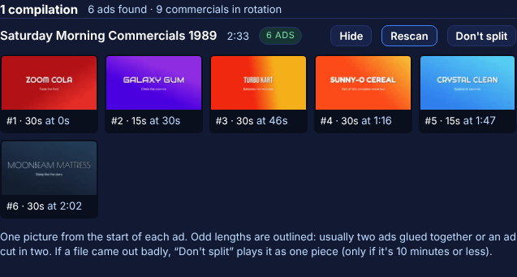 Long commercial compilations are split into separate ads automatically. | 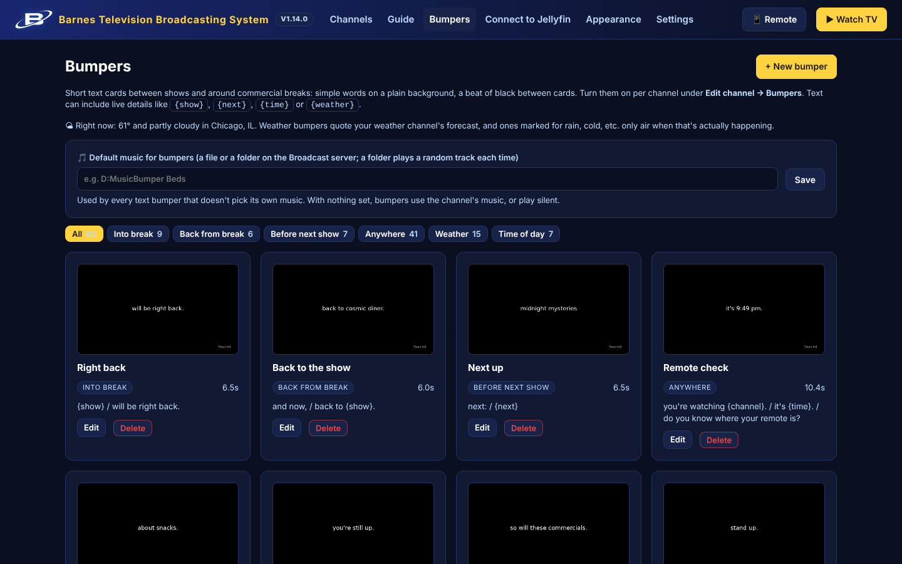 60+ built-in bumpers, including ones that quote the weather. |
| 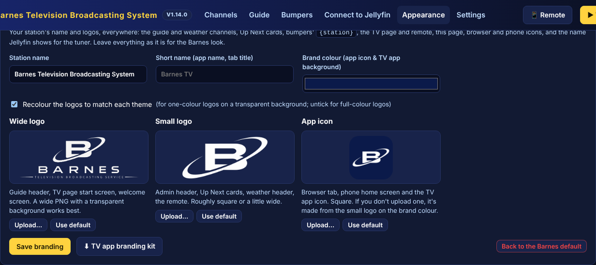 Rebrand everything with your own station name and logos. | 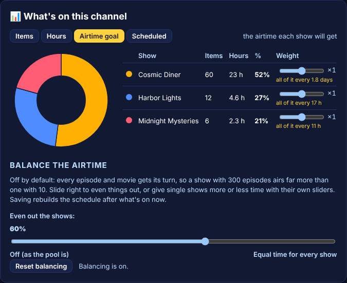 What each channel is made of, with optional airtime balancing per show. |
| 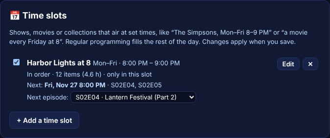 Time slots: a show at set times, picking up with the next episode. | 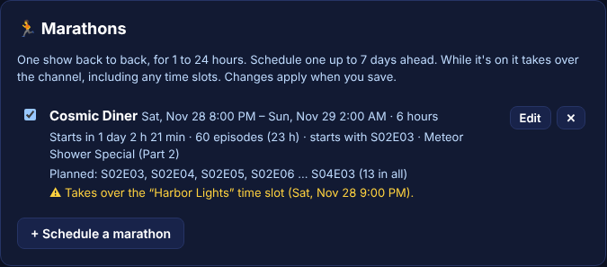 Marathons: one show back to back for up to 24 hours. |

Screenshots use a demo library of made-up shows. The demo's weather map is a simplified drawing, not real map tiles.

---

## Quick start

You need **Python 3.10+**, a **Jellyfin API key** (Jellyfin: **Dashboard → API Keys → +**) and ffmpeg, which is
found automatically (Jellyfin's own copy is used if it's there).

1. Get the project onto your Jellyfin machine (download the ZIP from GitHub, or `git clone`).
2. Start it: double-click **`start.bat`** on Windows, or run **`./start.sh`** on Linux. The first run sets everything
   up.
3. Open **http://localhost:8420**, go to **Settings**, enter your Jellyfin URL and API key, and click **Test
   connection** and **Save settings**.
4. In Jellyfin, add the M3U tuner and XMLTV guide shown on the app's **Connect to Jellyfin** page, then click
   **Refresh Guide Data**.
5. Back in the app, click **+ New channel**, pick what plays, and save. Tune in from Jellyfin's Live TV or at
   `http://localhost:8420/tv`.

Want it to start with Windows, survive power cuts, or reach your other devices through the firewall? The
**[User Guide](GUIDE.md#getting-started)** walks through all of it.

## Where to next

| I want to… | Read |
|---|---|
| Install it and connect it to Jellyfin | [Getting started](GUIDE.md#getting-started) |
| Build channels: sources, order, start times | [Building a channel](GUIDE.md#building-a-channel) |
| Put a show on at set times, or run a marathon | [Time slots](GUIDE.md#time-slots) · [Marathons](GUIDE.md#marathons) |
| Add YouTube videos, playlists or channels | [YouTube](GUIDE.md#youtube) |
| Add commercial breaks and bumpers | [Commercials tab](GUIDE.md#commercials-tab) · [The bumper library](GUIDE.md#the-bumper-library) |
| Set up the guide or weather channel | [Guide channel](GUIDE.md#the-guide-channel) · [Weather channel](GUIDE.md#the-weather-channel) |
| Watch on a TV, phone or Chromecast | [Watching](GUIDE.md#watching) |
| Lock channels for the kids | [Kids channels and the channel lock](GUIDE.md#kids-channels-and-the-channel-lock) |
| Change the look, fonts or branding | [Making it yours](GUIDE.md#making-it-yours) |
| Look up a setting | [Settings reference](GUIDE.md#settings-reference) |
| Fix a problem | [Troubleshooting](GUIDE.md#troubleshooting) |

## Credits

The bundled fonts in `web/fonts` are all under the SIL Open Font License (licence files are in `web/fonts/licenses`):
M PLUS Rounded 1c, DSEG, Inter, Bebas Neue, Orbitron, Rajdhani, Audiowide, Monoton, VT323, Share Tech Mono,
Press Start 2P, DotGothic16, Limelight, Poiret One, Josefin Sans, Atomic Age, Shrikhand, Righteous, Fredoka, Rubik
and Nunito.

The browser player uses [mpegts.js](https://github.com/xqq/mpegts.js) (Apache-2.0), and the QR codes use
[qrcode-generator](https://github.com/kazuhikoarase/qrcode-generator) (MIT), both bundled in `web/vendor`. The US radar
colour palette comes from the [Iowa Environmental Mesonet](https://github.com/akrherz/iem) (MIT).

## License

MIT: see [LICENSE](LICENSE). Bundled fonts and libraries keep their own licenses (above).
