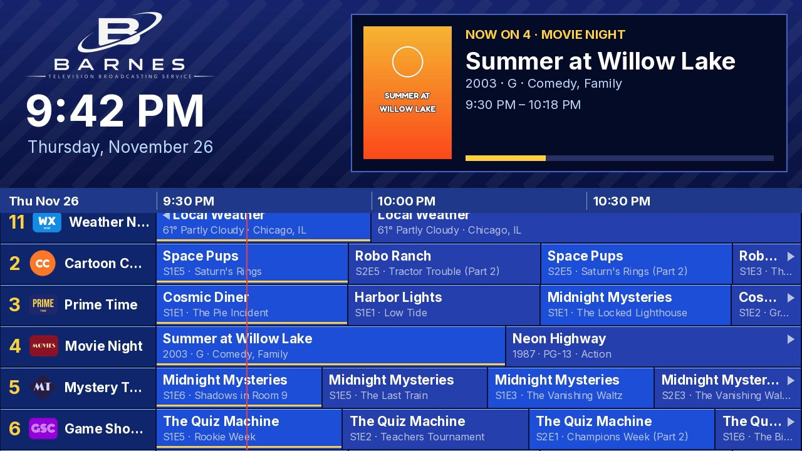
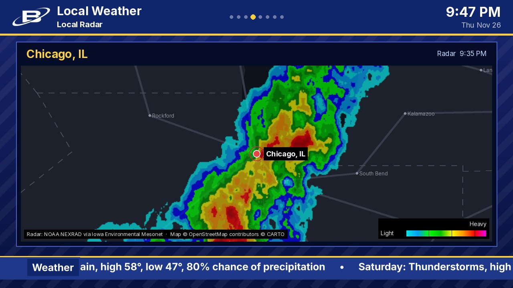
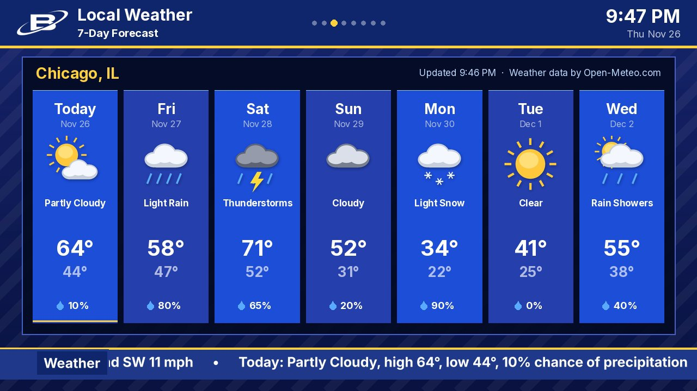
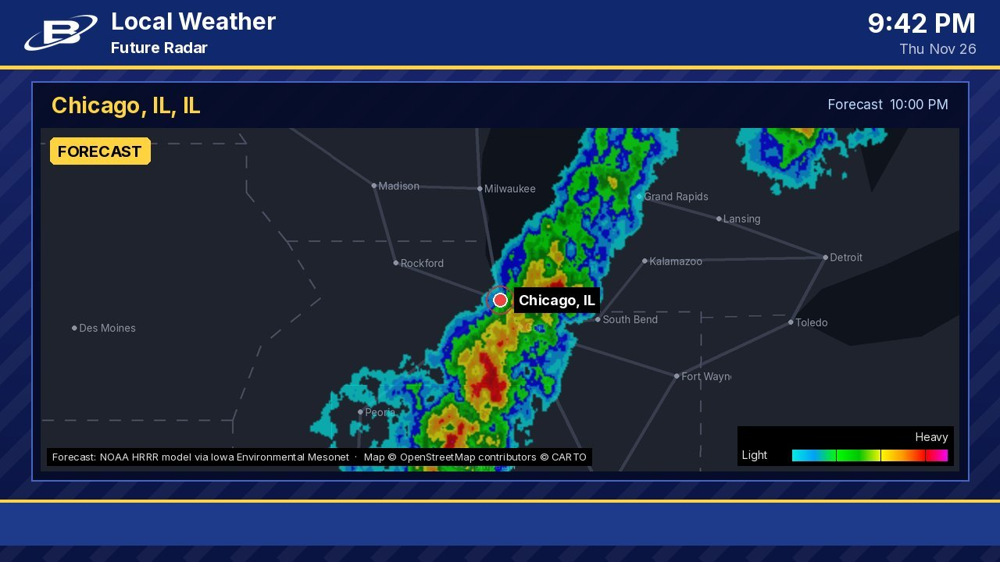
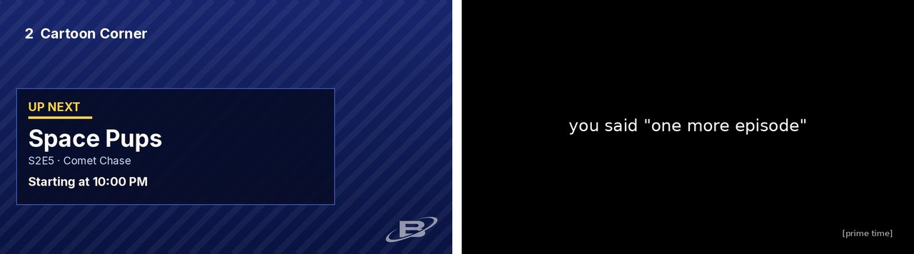

<p align="center"><picture>
  <source media="(prefers-color-scheme: dark)" srcset="web/brand/barnes-wordmark.png">
  
</picture></p>

# Barnes Television Broadcasting Service 📺

Barnes Television Broadcasting Service (BTBS) turns your Jellyfin library into **24/7 cable-style TV channels** that run on your own server. You
make channels such as Cartoons, Japanese TV, Movies or Sitcoms. Each one has a real schedule, so when you tune in you
land in the middle of whatever is "on" now. Each channel can also show a **logo in the corner you pick** and an
**on-screen clock**. There is a **scrolling guide channel** like the old cable guide channels.

The channels show up in **Jellyfin's Live TV** on every Jellyfin app (TV, phone, browser) with a full program guide.
You can also surf them in a browser at `http://<server>:8420/tv`.

It's a small companion app that runs next to Jellyfin. It works on **Windows and Linux**, and it can use the ffmpeg
that already comes with Jellyfin.

---

## Screenshots

<p align="center"><br>
<sub><b>The guide channel</b>: a scrolling, cable-style listing of every channel with a "now on" spotlight.</sub></p>

| | |
|---|---|
| <br><sub><b>Watching</b> in a browser or the TV app: channel bug, clock and the now/next banner.</sub> | <br><sub><b>The on-screen guide</b>: what's on now and next on every channel, driven by the TV remote.</sub> |
| <br><sub><b>The weather channel</b>: local radar looping over a street map, with a crawl along the bottom.</sub> | <br><sub>Current conditions, the next 12 hours, a 7-day forecast, sun &amp; moon and weather alerts.</sub> |
| <br><sub><b>Future radar</b> (US): the next three hours of forecast radar.</sub> | <br><sub><b>"Up Next" cards and bumpers</b> between shows and around commercial breaks.</sub> |

<p align="center"><br>
<sub><b>Themes</b>: the same guide in eight of the built-in looks. Or build your own.</sub></p>

**Admin page**

| | |
|---|---|
| <br><sub>Every channel at a glance, with what's on now.</sub> | <br><sub>Building a channel: sources, logo, clock, breaks and a live preview.</sub> |
| <br><sub>Long commercial compilations are split into separate ads automatically.</sub> | <br><sub>60+ built-in bumpers, including ones that quote the weather.</sub> |
| <br><sub>Rebrand everything with your own station name and logos.</sub> | <br><sub>What each channel is made of, with optional airtime balancing per show.</sub> |
| <br><sub>Time slots: a show at set times, picking up with the next episode.</sub> | <br><sub>Marathons: one show back to back for up to 24 hours.</sub> |

<sub>Screenshots use a demo library of made-up shows. The demo's weather map is a simplified drawing, not real map tiles.</sub>

---

## Features

- **Unlimited channels.** You build each one from any mix of libraries, genres, collections, single shows,
  playlists, tags or studios/networks. You can also exclude things, for example "no Horror on the kids channel."
- **Program order, per channel:**
  - *Shuffle*: everything plays once before anything repeats, with each show's episodes spread out through the mix.
  - *Rotate shows*: a random show in each slot, with each show's episodes in order, like classic reruns.
  - *In order*: plays in sequence, then loops.
  - *Pure random*.

  In every order, **the same show never airs twice in a row** when the channel has anything else to play. "In order"
  takes turns between shows (each show's episodes still in order). With one big show and one tiny one, the tiny
  one will rerun more often to keep them apart. Untick **Never play the same show twice in a row** on a channel to
  turn this off.
- **Time slots.** Put a show, movie or collection on at set times, for example *The Simpsons, Mon–Fri 8–9 PM* or
  *a movie every Friday at 8*. Regular programming fills the rest of the day.
- **Marathons.** One show back to back for 1 to 24 hours, scheduled up to 7 days ahead.
- **See what a channel is made of, and balance it.** Each channel's page has a pie chart of its pool, by number of
  items or by hours, plus the airtime each show is set to get and what's actually scheduled. Balancing is off by
  default. You can slide **Even out the shows** toward equal time so a 300-episode show doesn't drown out a
  10-episode one, or give single shows more or less time with their own sliders.
- **Real TV timing.** Programs can start back-to-back, or on the hour, half hour or quarter hour. The gaps are filled
  with your own filler (commercials, music videos, shorts) and then an "Up Next" card.
- **Commercial breaks.** Shows pause every few minutes (you choose how often and how long) for spots from your own
  "Commercials" library, then resume at the exact frame where they stopped. Breaks can snap to the file's chapter
  marks so they land on natural act breaks, like real TV.
- **Bumpers.** You write short text cards on a plain background (white on black by default) with a beat of black
  between cards. They can play going into a break, coming back ("and now, back to {show}"), or before the next show
  ("next: {next}"). You can also add your own video bumpers from Jellyfin.
- **Channel logo ("bug").** You can put it in any of the four corners, with adjustable size and transparency.
- **Clock toggle.** You can place it in any corner, with 12- or 24-hour time (with or without AM/PM or seconds). By
  default it sits in the top-left. If the logo uses the same corner, the clock stacks neatly under it. You choose its
  font, colour, opacity, outline, drop shadow and the bar behind it. One-click styles include **Japanese broadcast**
  (rounded gothic with a thick outline), VCR 7-segment, news ticker, teletext, neon and subtle.
- **13 station themes.** Each theme restyles the guide channel, the "Up Next" and standby cards, the Up Next banner,
  the admin page, the TV page and the phone remote. The themes are Barnes Classic, Retro Cable, Groovy '70s, Sleek
  Futuristic, Art Deco, Corporate Memphis, Synthwave, Teletext, Tokyo Broadcast, Frutiger Aero, Green Phosphor,
  Atomic Age and 8-Bit Arcade. Any channel can use its own theme. The **theme builder** lets you make your own.
- **Weather channel**: current conditions, the next 12 hours, a 7-day forecast, local and regional radar loops, sun
  and moon, US severe weather alerts and a scrolling crawl, with your music, in any theme. Location comes from your
  internet connection, a ZIP code, a city or coordinates.
- **Subtitles**, burned into the picture: always, only "forced" (signs and songs), or only when the audio isn't
  in your language. Works with text (SRT/ASS) and Blu-ray/DVD picture subtitles.
- **TV app for Google TV / Android TV**: watch on the TV itself with the TV remote (see "TV app" below).
- **Restart server** button for clearing out any stuck streams in one click.
- **Font library.** 22 bundled fonts, plus any `.ttf`/`.otf` you add. You can pick fonts for the clock, the guide
  channel, bumpers and the admin page.
- **"Up Next" banner.** It slides in near the end of each show.
- **Guide channel.** It's a live channel with a big clock, a "Now On" spotlight with poster art, and a smoothly
  scrolling grid of every channel. Background music is optional.
- **Per-channel audio language.** For example, Japanese audio on the anime channel.
- **Optional loudness leveling** for each channel.
- **Deinterlacing** of old TV recordings and **HDR→SDR tone mapping**.
- **Hardware encoding** with NVIDIA NVENC, Intel QSV, AMD AMF, VAAPI or VideoToolbox. CPU encoding (libx264) works
  everywhere.
- **On-demand encoding.** A channel only runs ffmpeg while someone watches it. Several viewers of the same channel
  share one stream.
- **Ways to connect:** an M3U playlist with an XMLTV guide (Jellyfin's built-in Live TV), and HDHomeRun emulation
  for Plex, Emby or Channels DVR.
- **Browser TV** with channel up/down, number entry, an info banner, a guide overlay and static between channels.
- **Cast to Chromecast or Google TV** from the browser TV page or the admin page. Your phone becomes the remote:
  channel up/down, guide, volume. Your logo and clock show on the TV because they're part of the video itself.
- Any change you make to a channel's graphics applies to the stream within seconds. People who are watching stay
  connected.

## Requirements

| | |
|---|---|
| **Python 3.10+** | Windows: `winget install Python.Python.3.12`, or get it from python.org (tick "Add to PATH"). Linux: usually already installed. Install `python3-venv` if needed. |
| **ffmpeg** | Found automatically. It looks for **Jellyfin's own ffmpeg** first (`C:\Program Files\Jellyfin\Server\ffmpeg.exe` or `/usr/lib/jellyfin-ffmpeg/ffmpeg`), then for any ffmpeg on your PATH. |
| **Pillow, PyChromecast** | Installed automatically by the start script. |
| **A Jellyfin API key** | Create one in Jellyfin: **Dashboard → API Keys → +**. |

It's easiest to run it on the same machine as Jellyfin, but it doesn't have to be. By default it streams media
from Jellyfin over HTTP, so it works from any machine that can reach Jellyfin.

## Quick start

### Windows
1. Copy this folder to the Jellyfin box, for example `C:\JellyfinBroadcast`.
2. Double-click **`start.bat`**. The first run sets everything up.
3. Open **http://localhost:8420** and go to **Settings**. Enter your Jellyfin URL (`http://localhost:8096`) and the
   API key, then click **Test connection** and **Save settings**.
4. *Optional:* to start it automatically with Windows, run this from an **administrator** PowerShell in the folder:
   ```powershell
   powershell -ExecutionPolicy Bypass -File scripts\install-windows-startup.ps1
   ```
   This registers a hidden startup task and opens Windows Firewall for devices on your local network, whatever
   network type Windows thinks it is. It also removes any firewall "block" rules for Python left over from an
   earlier "allow this app?" prompt, because those override every allow rule. At the end it prints the addresses to
   use from your other devices. If you skip this step, Windows Firewall will ask the first time instead.

   The task starts at boot, before anyone signs in, and restarts the server if it ever quits. To stop it by hand, use
   **End** on the "Barnes TV Broadcast" task in Task Scheduler: that stops the server and all its ffmpeg processes.
   **Run** starts it again. After installing it,
   close any `start.bat` window, because only one copy can use port 8420. To ride out power cuts, also set the PC's
   BIOS/UEFI option **Restore on AC power loss** (also called *After power failure* or *AC back*) to **Power On**,
   and set Windows **Sleep** to **Never**. Add `-Check` to see whether the server is running and how the firewall is
   set up (it changes nothing), or `-AnyAddress` if you also connect from outside your network, for example over a
   VPN. To remove the task: `powershell -ExecutionPolicy Bypass -File scripts\install-windows-startup.ps1 -Uninstall`

### Linux
```bash
./start.sh                       # or: python3 broadcast.py --port 8420 --data ./data
```
To run it as a service, see `scripts/jellyfin-broadcast.service`.

Options for both: `--port 8420`, `--data <folder>` (where settings and schedules are kept) and `--host 0.0.0.0`.

## Hook it up to Jellyfin

The **Connect to Jellyfin** page in the app shows these addresses with copy buttons.

1. In Jellyfin, go to **Dashboard → Live TV → Tuner Devices → +** and choose **M3U Tuner**. Enter
   `http://<broadcast-server>:8420/iptv/channels.m3u`.
2. Go to **TV Guide Data Providers → +** and choose **XMLTV**. Enter
   `http://<broadcast-server>:8420/iptv/xmltv.xml`. *Optional:* set "Movie categories" to `Movie`.
3. Click **Refresh Guide Data**. Your channels, logos and listings now appear under **Live TV** in every Jellyfin app.

If Jellyfin runs on the same machine, `<broadcast-server>` can be `localhost`. If it doesn't, use the machine's LAN
IP. You can pin that address under **Settings → Address Jellyfin uses to reach this app**.

## Building channels: recipes

| Channel | Sources | Order | Start times | Extras |
|---|---|---|---|---|
| **Saturday Morning Cartoons** | Genre *Animation*, with Genre *Horror* excluded | Rotate shows | Half hour | Filler: a "Commercials" library of old ads |
| **Japanese TV** | Library *Anime* or Tag *japanese* | Rotate shows | Half hour | Audio language: Japanese |
| **Movie Channel** | Library *Movies* (shortest item 60 min) | Shuffle | On the hour | "Up Next" banner, clock off |
| **Network channel** | Studio *Cartoon Network* or *Fuji TV* | Rotate shows | Half hour | Logo bottom-right at 60% opacity |
| **Marathon** | Series *one show* | In order | Back-to-back | |

**Tip:** a "Commercials" or "Bumpers" library makes the half-hour padding feel just like real TV. Add a library of
short clips in Jellyfin (Home Videos type works well), then pick it under **Filler for the gaps**.

### Balancing shows

A channel plays every episode and movie in its pool once before repeating, so its airtime follows the size of each
show: if one show has 300 episodes and another has 10, the big one gets most of the time. The **What's on this
channel** card shows this as a pie chart. Use **Items**, **Hours**, **Airtime goal** or **Scheduled** to switch what
the chart shows.

- **Even out the shows** is off by default (0%). At 100%, every show gets the same airtime. In between, big shows
  still get more time, just less of a lead.
- Each show also has a **weight** slider, from ×0.25 to ×4, to fine-tune a single show. All movies count as one
  "show", and so do all other clips.
- When balancing gives a small show a lot of airtime, it repeats more often. The table warns you when a show will
  run through all of its episodes in under two days.
- With **Never play the same show twice in a row** on, no show can air more than every other slot, so a goal above
  about 50% can't be met. The card tells you when that happens.

Saving rebuilds the schedule, starting after whatever is on now. Turn the slider back to Off, or click **Reset balancing**, to
return to the original behavior.

### Time slots

Under **Edit channel → Time slots**, **+ Add a time slot** puts something on at set times. Regular programming fills
the rest of the day. For each slot you choose:

- **What plays:** a series, collection, playlist, genre, or anything else you can add to a channel. It doesn't have to
  be part of the channel's regular programming.
- **When:** days of the week (with **Mon–Fri**, **Weekends** and **Every day** shortcuts) or a single date, and the start
  and end times. An end time earlier than the start runs past midnight. You can also limit a weekly slot to a range of
  dates, such as a holiday season.
- **How much:** keep playing from the start time to the end time, or play **one episode or movie** at the start time
  and then go back to regular programming.
- **Order:** **In order** plays the next episode each time, like a real weekly show, and picks up where it left off.
  **Shuffle** and **Random** are also available.
- **When it's time to start:**
  - **Start on time** (default): whatever is on before ends early. A shorter show, or the channel's filler and an "Up
    Next" card, fills the gap.
  - **Cut off** whatever is playing.
  - **Wait** for it to finish, so the slot starts late.
- **If the next one would run past the end:**
  - **End on time** (default): don't start it; filler and an "Up Next" card fill the rest.
  - **Let it finish**, even past the end time.
  - **Cut it off** at the end time.

  The first program of a slot always airs, even if it's longer than the slot.
- **Commercial breaks** during the slot (on by default, using the channel's break settings).
- **Only show this in its time slot**, to take it out of the channel's regular programming.

Each slot in the list shows what it found in Jellyfin and when it airs next, with the episodes. For **In order** slots,
**Next episode** lets you pick where it continues from. A slot can be turned off with its checkbox without deleting it.
If two slots overlap, the card warns you. When they overlap, the one that starts first plays and the other is skipped
that day. Time slots appear in the schedule, the guide and the EPG like any other program, marked 📅 on the channel's
page. Saving re-plans the schedule, starting after whatever is on now.

### Marathons

Under **Edit channel → Marathons**, **+ Schedule a marathon** puts one show on back to back. You choose:

- **Which show:** usually a single series. A collection or playlist also works.
- **Day and start time:** up to 7 days ahead.
- **How long:** 1 to 24 hours. The slider shows when it will end.
- **Start with:** the first episode or any episode you pick. The marathon plays **in order** from there, or
  **shuffled**. If the show runs out before the marathon ends, it starts over from the beginning.
- **When it's time to start** and **if the last episode would run past the end:** the same choices as time slots.
- **Commercial breaks** during the marathon.

While a marathon is on it takes over the channel, including its time slots. A time slot that's running when the
marathon starts ends there, and slots that would start during it are skipped that day. The Time slots and Marathons
cards both say when this happens. Each marathon in the list shows when it starts (or that it's on now), the episodes
it has planned, and any warnings. The channel's schedule marks marathon programs with 🏃. A channel plans far enough
ahead to include an upcoming marathon, so it's in the guide and the EPG as soon as you save, even if it's further out
than **Days of schedule to plan ahead**. Finished marathons stay in the list until you delete them.

### Commercial breaks

1. In Jellyfin, create a library for your commercials. *Home Videos* type works well. Fill it with short clips:
   old ads, station IDs, trailers.
2. Edit a channel, go to **Commercial breaks**, turn them on and pick that library. Then set:
   - **Minutes of show between breaks.** About 7–8 feels like a half-hour sitcom. 12–15 feels like a movie channel.
   - **Break length.** Breaks are filled with whole commercials up to this length.
   - **No breaks in the last … minutes**, so the ending isn't interrupted.
   - **Max breaks per show**, and whether breaks happen during episodes, movies or both.
   - **Snap to chapter marks.** If a file has chapters near a break point, for example the act breaks in a TV rip,
     the break moves to that chapter.
3. Save. The break plan applies from the next show onward.

Every hand-over between clips costs the stream a moment, so a channel can run a few seconds behind its schedule.
Ads, bumpers and a show's return from a break still always start from their first frame. The channel catches up by
dropping a whole commercial once it's more than about 6 seconds behind, so nothing gets clipped.

During a break, the stream switches to the commercials. Afterwards, it seeks back into the show and continues from
the exact frame where it stopped. The program guide, Jellyfin's guide and the "now playing" info keep listing the
show as one block. By default, the channel logo and clock are hidden during commercials, the way broadcasters do it.

#### Commercial compilations

You don't need to cut compilation videos ("80s Commercials, 12 minutes") into separate clips. Put them in the
commercials library as they are. With **Find the separate ads inside long commercial videos** on (the default), every
commercial video longer than 90 seconds (adjustable) is scanned once in the background. The scan looks for the black,
silent frames between ads. When ads are joined by hard cuts instead, it looks for scene changes that land on standard
ad lengths (15, 30, 60 seconds...). Each ad found then plays on its own, straight from the original file. Nothing is
cut or re-encoded.

- Scanning reads the whole file once, one file at a time, at low priority. Expect roughly a tenth to a third of the
  video's length per file, depending on resolution and your CPU. Ads become available as files finish.
- Files with chapter marks at each ad use those instead.
- The channel's **Commercial breaks** card lists every compilation and how many ads were found. **Review** shows one
  picture from the start of each ad. Odd lengths are outlined, because those are usually two ads glued together or
  one ad split in two. **Rescan** scans a file again, and **Don't split** plays a file as one piece (only if it's 10
  minutes or less).
- Known limit: two ads joined by a hard cut with no pause, in a stretch that is itself a normal ad length (for
  example 30 + 15 = 45 seconds), stay together.

### Bumpers

Open **Bumpers** in the top menu. The app comes with about 60 built-in bumpers in a deadpan late-night style, to use
as they are, edit or delete. The filter buttons at the top sort them by where they play, weather and time of day. If you
delete built-in ones and want them back, **Restore built-in bumpers** returns them. Each bumper is a short sequence
of text cards. For each one you set:

- **Where it plays:**
  - *Going into a break*, for example "{show} / will be right back."
  - *Coming back from a break*, for example "and now, / back to {show}."
  - *Before the next show*, for example "next: / {next}."
  - *Anywhere*: random thoughts, station IDs, "it's {time}. you're still up."
- **When it plays** (optional):
  - a time of day: late night, mornings, daytime, evenings, or weekends
  - a kind of weather from your weather channel: raining, snowing, thunderstorms, clear, cloudy, foggy, hot, cold,
    freezing, windy, or nice out
- **Cards:** the text, and how many seconds each card stays on screen. You can also set the beat of black between
  cards.
- **Font:** pick from a gallery that shows each font in your bumper's colors. Your own fonts are included.
- **Look:**
  - background and text color
  - regular or bold weight
  - size, centered or left alignment
  - all-lowercase, as typed, or ALL CAPS
  - a small corner tag such as `[{channel}]`
  - optionally your own font file and music. Bumpers without their own music use the **Default music for
    bumpers** set at the top of the Bumpers page (a file, or a folder for a random track each time). If that's not
    set either, they use the channel's music, or play silent.
- **Music volume:** music is mastered much louder than TV, so by default every music track is measured once (in the
  background, the first time it's used) and turned down to the same loudness as the shows. On channels with **Even
  out loudness** on, music matches that level instead. The **Music volume** slider under the default music adds your
  own adjustment on top, from -30 to +10 dB. It covers all background music: bumpers, "Up Next" cards, the guide and
  the weather channel. Untick **Match music to the shows' volume** to play music as recorded, with only the slider
  applied.
- **Live details** in the text: `{show}`, `{episode}`, `{next}`, `{next_time}`, `{channel}`, `{number}`,
  `{station}`, `{time}` and `{day}`.
- **Weather details** from your weather channel's forecast: `{weather}` ("41° and light rain"), `{temp}`,
  `{feels_like}`, `{conditions}`, `{high}`, `{low}`, `{rain_chance}`, `{wind}`, `{humidity}`, `{tomorrow}`,
  `{tomorrow_high}`, `{sunrise}`, `{sunset}`, `{city}`, `{weather_channel}` and `{weather_number}`.

Time-of-day bumpers are only scheduled into their hours. Weather bumpers are checked just before they air. If the
weather doesn't match (a "raining" bumper on a sunny day), or there's no forecast to quote, a different bumper of the
same kind plays instead. With no weather channel set up, weather bumpers are left out entirely.

The preview shows each card as you type, and **▶ Play** runs the whole bumper with its timing.

**Music** for the guide, the weather channel and bumpers starts at a random point in the song each time (never in its last
minute), so a bed doesn't always open the same way.

Then edit a channel, go to **Bumpers**, turn them on, and choose where they play and which ones to use.
**Bumpers around commercial breaks** sets how often breaks get them: every break, or every 2nd, 3rd or 4th break. You can also
add **video bumpers** from a Jellyfin library. These are clips you made yourself, mixed in anywhere. If you edit a
bumper's text, the change shows up next time it airs. New bumpers are added to the schedule straight away.

**The guide channel** is channel 1 when you first start the app. Edit it to change its number, add background music
(a file or a folder of music on the Broadcast machine), or change the scroll speed. It lists every channel that's on
the air.

## Watching in a browser

Open `http://<broadcast-server>:8420/tv` and click to turn the TV on. Then use these controls:

- **↑/↓** or **PgUp/PgDn**: change channel
- **+/−**, **[/]** or the mouse wheel: volume (remembered between visits)
- **digits**: jump to a channel number
- **G**: guide
- **I**: info banner
- **M**: mute
- **F**: fullscreen

On a phone, tap the picture to show the controls (Ch −/+, Guide, Info, Sound, Cast) and swipe up or down to change
channel. Playing video in the browser needs Chrome, Edge, Firefox or desktop Safari. iPhones can't play these streams
in a browser, but they can still cast and act as the remote.

### Screen off (sleep channels)

**🌙 Screen off** turns the picture pitch black while the sound keeps playing. It's on the control bar, and also the
last rows of the guide: **Turn the screen off**. That guide row is how you do it in the Barnes TV app with the TV remote.
Any button, a click or a tap brings the picture back without changing the channel. Volume keys keep working in the
dark. On a TV, "black" means the panel shows black: an OLED goes fully dark, while an LCD's backlight stays on.

To make a **sleep channel**, edit the channel and set **🌙 Sleep channel** to turn the screen off by itself 1–30
minutes after you tune in or last press a button. Screen off isn't available while casting to a Chromecast.

### Phone remote

Open `http://<broadcast-server>:8420/remote` on your phone. The **Connect to Jellyfin** page in the admin has a QR
code for it, so you can just scan it with the camera. Then pick a TV.

- **Controls:** big channel and volume rockers, a volume slider, mute, a number pad, the guide (tap a show to tune),
  and what's on now and next.
- **Controlling a TV that's already playing:** if someone else started casting, choose that TV and the remote takes
  over without restarting the channel.
- **Coming back later:** reopening the page reconnects to the TV you used last.
- **Home screen:** use the browser's **Add to Home screen**, and the remote opens full-screen like an app.

The remote only sends commands, so it uses almost no data and works on any phone, including iPhone.

## Kids channels and channel lock

1. Edit each channel that's fine for kids and tick **🧸 Kids channel**. The TV Guide channel is always available.
2. In **Settings → Channel lock**, choose a 4–8 digit code and tick **Lock every channel that isn't marked as a Kids
   channel**.

With the lock on:
- **Locked channels ask for the code.** Tuning to any non-kids channel on the TV page or the phone remote shows a lock
  screen with a number pad. You can also type the code on a keyboard.
- **The code unlocks that one device** for the time you choose, 60 minutes by default. The guide has a **🔒 Lock**
  button to lock it again early.
- **🧸 Go to a kids channel** jumps to the next channel that's allowed.
- **Casting is covered too.** Casting a locked channel to a TV asks for the code on the phone first.
- **The settings are locked.** Changing anything in the admin page, including turning the lock off or changing the
  code, asks for the code, unless you've set an admin password.
- **The server enforces all of this**, so typing a stream address into a browser doesn't get around it. Five wrong
  codes in a row trigger a one-minute cool-down.

**Jellyfin:** Jellyfin can't ask for a code, so the playlist this app gives Jellyfin carries a private key that plays
every channel. After you first turn on the lock, click **Refresh Guide Data** in Jellyfin so it picks up the new
links. If kids use the Jellyfin app too, tick **Also hide locked channels from Jellyfin**, and Jellyfin will only
list the kids channels (refresh its guide after changing this). It's meant to keep kids out, not to stand up to a
determined adult on your network: anyone who finds the Jellyfin playlist address can use those links.

## Casting to a Chromecast

1. Open `http://<broadcast-server>:8420/tv` on your phone or computer. Then press **C** or tap **Cast**, and pick your
   TV.
2. The page turns into a remote: ▲/▼ change channel, and there are buttons for the guide, volume and **Stop casting**.
   If you reopen the page later, it picks the remote back up.
3. You can also use the **Cast…** button on any channel in the admin page.

**How it works:** Chrome's built-in Cast button only works on HTTPS sites. So instead, the Broadcast server finds the
Chromecasts on your network and tells them to play the channel as an HLS stream through Google's standard media
player. No app registration or certificates are needed, and the remote works from any phone, including iPhone.
Turning the channel into an HLS stream doesn't re-encode the video, so it adds almost no load. It stops by itself
about 25 seconds after the TV stops watching.

**If the TV shows a grey screen with a Cast icon:** the TV page's cast panel now says why, in plain words.
- *"The TV never requested the stream…"*: the TV can't reach this computer. On Windows, run
  `powershell -ExecutionPolicy Bypass -File scripts\open-firewall.ps1` from an administrator PowerShell. It works
  whether Windows has your network set to Private or Public, and it clears out old firewall rules that block Python.
- *A Cast error code* (for example 315): the TV reached the stream but rejected it. `broadcast.log` has the details.
  You can also try **Settings → Chromecast → stream format**.

**Good to know:**
- The TV must be able to reach the Broadcast server. If the address shown under **Settings → Chromecast** is wrong,
  set **Address Jellyfin uses to reach this app** to the server's LAN IP.
- If no TVs show up, check that the TV is on the same network. On Windows, also check that the firewall allows
  discovery: the startup script adds that rule for you. As a fallback, you can type the Chromecast's IP address
  under **Settings → Chromecast**.
- The TV plays a few seconds behind live, so its buffer never runs dry. Channels that are already being watched
  start almost instantly, because the server keeps the last ~20 seconds of each running channel in memory.
- If `broadcast.log` says a channel *"is only encoding at 0.8x real time"*, the computer can't encode fast enough.
  Viewers will buffer no matter what. Pick a faster preset, 720p, or your GPU under **Settings → Video**.
- Changing channels takes a few seconds on a Chromecast. That's how long it takes the Chromecast to start a new
  stream. When you flip through channels quickly, the TV only loads the one you stop on.
- **Stuck picture:** the server checks each TV every few seconds. If a picture that was playing freezes or buffers
  for 25 seconds, the player stops with an error, or it never starts within about a minute, it reloads the channel on
  the TV by itself (up to 5 times in a row; after that the remote shows what to check). It only watches while the Cast
  player is open on the TV: press Home or Back on the TV and it leaves the TV alone. You can also tap **Picture stuck? Restart the stream on the TV** on the
  remote. To turn the automatic restart off, untick it under **Settings → Chromecast**.
- Jellyfin's own apps may also be able to cast these channels with their Cast button, because to Jellyfin they're
  regular Live TV channels.

## Performance notes

- Each channel that **someone is watching** runs one ffmpeg encode. Idle channels cost nothing. A modern quad-core
  CPU handles a few 720p channels with libx264 at the `veryfast` preset.
- If you have a GPU, pick it under **Settings → Video → Encoder**: NVENC (NVIDIA), QSV (Intel) or AMF (AMD) on
  Windows, and NVENC, QSV or VAAPI on Linux.
- **Direct file access** (Settings → Media access) is faster than streaming from Jellyfin when both apps run on the
  same box. Add path mappings if the paths Jellyfin reports differ from how this machine sees the files.

## How it works

```
Jellyfin library ──► scheduler ──► persistent timeline per channel (3 days ahead, saved in data/state)
                                      │
viewer tunes in ──► session: one ffmpeg per program (seeks to the right spot, scales, logo + clock overlays)
                                      │   pieces are stitched into one continuous MPEG-TS stream
                                      ▼
                       /stream/<channel>.ts ──► Jellyfin Live TV, VLC, browser TV page
                       /iptv/xmltv.xml      ──► Jellyfin's program guide
```

- Schedules are planned ahead and saved, so the guide is always accurate. When the library changes, only the future
  schedule is affected. **Rebuild schedule** on a channel reshuffles everything after the program that's on now.
  **Rebuild including now** re-reads the library and starts a fresh schedule this second, replacing what's on too.
- **⏭ Skip what's on** moves on right away. If a show is on, the whole show is skipped, including its remaining
  parts and breaks, and a new one starts. If an ad or bumper is on, only that clip is skipped and the rest of the break
  moves up.
- If a file can't be played, the channel shows a "Please Stand By" color-bars card until the next program. Details go
  to that channel's **Log**. **Skip what's on** gets past it without waiting.

## Troubleshooting

- **"ffmpeg not found"**: set the path in Settings, for example `C:\Program Files\Jellyfin\Server\ffmpeg.exe`.
- **"certificate verify failed" / "certificate has expired"** (weather, maps): Python's list of trusted certificates
  is out of step with Windows'. This happens most when the server runs from the startup task. The app checks
  certificates the way Windows does (the `truststore` package) and falls back to Mozilla's list (`certifi`). Both are
  installed by `start.bat`, and by `install-windows-startup.ps1` each time you run it.
- **Jellyfin can't load the M3U or the guide**: from the Jellyfin machine, check that
  `http://<broadcast-server>:8420/iptv/channels.m3u` opens in a browser. If it doesn't, check the firewall and the
  "Address Jellyfin uses" setting.
- **Channel stuck on "Please Stand By"**: open the channel's **Log**. The usual causes are a wrong API key, a path
  mapping problem in direct mode, or an unsupported encoder choice.
- **Japanese titles show boxes**: this shouldn't happen any more, because the bundled Maru Gothic font covers Japanese.
  For Chinese or Korean titles, set a CJK font in Settings. On Windows, Yu Gothic, Meiryo or Malgun Gothic are found
  automatically. On Linux, install `fonts-noto-cjk`.
- **"No matching distribution found for PyChromecast"**: your Python is older than the newest PyChromecast
  supports. The app works with PyChromecast 13.1 on Python 3.8–3.10, and `start.bat` installs that automatically.
  If pip still fails, the app starts without casting. Installing Python 3.12 (`winget install Python.Python.3.12`)
  and deleting the `.venv` folder gets you the newest version.
- **Clock shows the wrong time**: the clock uses the Broadcast machine's time zone.
- Everything the app stores is in the `data` folder. Delete `data/state` to throw away all schedules.

## Known limitations

- The browser TV page can't play on iPhone. Use Jellyfin's Live TV there.
- Hardware encoders depend on your drivers and ffmpeg build. If one fails, switch back to CPU.

## Themes and fonts

Open **Appearance** in the admin page. Click a theme to preview it: the admin page restyles itself immediately, and
you see a guide channel frame and an "Up Next" card in that theme. Click **Save** to apply it. A running guide
channel switches to the new look within a few seconds, with no restart.

- **One channel, different theme:** open the channel and pick a **Theme**. On a regular channel, it changes that
  channel's Up Next and standby cards, its Up Next banner and its default clock font. On the guide channel, it
  changes the whole guide.
- **Guide channel fonts:** open the guide channel. It has its own **Listings font** and **Clock & channel numbers
  font**. Leave either one on "Theme default" to follow the theme.
- **Clock:** open a channel and go to **On-screen graphics → Clock**. Choose a quick style, or set the font, colour,
  clock opacity, bar behind the time, outline and shadow yourself. The sample updates as you go. Click **Preview**
  after saving to see it on real video. The 7-segment faces only have digits, so pair them with 24-hour time or
  "no AM/PM".
- **Admin page, TV page and remote font:** under **Appearance → Fonts**.
- **Bumpers:** each bumper's **Look** card has a **Font** menu.
- **Your own fonts:** drop `.ttf` or `.otf` files into the `fonts` folder inside the data folder (the Appearance page
  shows the exact path), then reload the page. They're listed under "Your fonts" in every font menu.

### Theme builder

On **Appearance**, click **Create a theme** (or **Copy & customise** on any theme). You can change:
- **Colours** for every part of the guide channel (background, header, channel column, up to four alternating
  programme-box colours, time bar, spotlight, "now" line), the text and highlight colours, and the admin/TV page
  colours.
- **Fonts** for the pages, headings, guide listings, guide clock and the on-screen clock.
- **Style**: the shape of the programme boxes (flat, bevelled, rounded, cut corners, art deco double frame, chunky,
  glossy, pixel…), a header decoration from any built-in theme, corner rounding, spacing, neon glow, scanlines, ALL
  CAPS, genre-coloured boxes, light or dark, the logo's colour, and how the admin/TV pages look.

The guide and "Up Next" previews redraw a moment after each change, and the admin page restyles itself live. Click
**Save & use for the station** to put it on air, or **Save** to keep it for later. Your themes appear alongside the
built-in ones everywhere, including each channel's **Theme** menu. A running guide channel picks up edits to the
theme it's showing within a few seconds. Deleting a theme sends anything that used it back to the station theme.

Japanese titles are always readable. If a font has no Japanese characters, those titles switch to a Japanese-capable
font (the bundled Maru Gothic if Windows doesn't have one).

## Weather channel

Add a channel and set **Type** to **Weather channel**, then save. It's drawn live like the guide channel and rotates
through these screens (tick the ones you want, in the channel's **Weather channel** card):

- **Current conditions**: temperature, sky, feels-like, humidity, dew point, wind and gusts, pressure, visibility, UV
  and cloud cover, plus today's high and low and sunrise and sunset.
- **Next 12 hours**: an icon, temperature curve and chance of rain or snow for each hour.
- **7-day forecast**: a box for each day.
- **Local and regional radar**: the last hour of radar looping over a street map, with your location marked. If the
  newest radar picture is more than 40 minutes old, a "Radar delayed" notice says so. Pictures over 3 hours old are
  never shown.

  In the US, weak echoes are hidden. Most nights, and on calm days, the radars run in a sensitive "clear-air" mode
  and pick up bugs, birds, dust and temperature layers. Unfiltered, that shows up as grey-blue static across the map
  and beige rings around each radar site. By default anything below 10 dBZ is left out, which removes the static and
  keeps drizzle and light snow. Lone specks are cleaned up too, and what's left is drawn in the standard NWS colors
  that match the legend. Change it with **Radar: hide weak echoes** in the channel's **Weather channel** card, from
  **Show everything** (the raw radar) up to **Below 20 dBZ** (rain only).
- **Future radar** (US): forecast radar for the next 3 hours, every 30 minutes, from NOAA's HRRR model, clearly
  marked FORECAST. Outside the US this screen is skipped: RainViewer ended its free forecast radar in January 2026.
- **Sun & moon**: sunrise, sunset and daylight for today and tomorrow, peak UV, and the moon's phase.
- **Weather alerts** (US): watches, warnings and advisories from the National Weather Service, shown only when
  something is active. Alerts also lead the crawl.

A crawl along the bottom scrolls the current conditions and the next few days. The channel follows its **Theme**
(colours, fonts, box style, decorations; light themes get a light map) and has its own text and big-number fonts.
Background music works like the guide channel: a file or a folder on the Broadcast server.

**Location:** **Automatic** works out where you are from your internet connection. You can also use a **ZIP / postal
code** (with its 2-letter country code), a **city name**, or **exact coordinates**, and give it the name you want shown.
Click **📍 Check location & weather** to see what it found. Units are automatic (°F, mph and inches in the US;
°C, km/h and hPa elsewhere) or your choice.

**Where the data comes from:** forecasts from [Open-Meteo](https://open-meteo.com), alerts from the US National
Weather Service, radar and forecast radar from NOAA via the
[Iowa Environmental Mesonet](https://mesonet.agron.iastate.edu) in the US, radar from
[RainViewer](https://www.rainviewer.com) elsewhere, and maps from OpenStreetMap / CARTO. All are free for personal use
with no account or key, and each is credited on screen. Forecasts refresh every 10 minutes, and alerts and radar every
5. Each radar refresh only downloads the newest picture, and a failed refresh tries again within 2 minutes. If the internet drops, the channel keeps showing the last good forecast. The street maps under the radar
come from CARTO, which needs a free key; it's set under **Settings → Weather maps** (get one at
carto.com/basemaps/apikey and leave the website field blank, so it works from your server). Radar zoom is limited to level 7, so local radar covers an area about 350 miles across and regional radar about
1,400.

## Subtitles

Open a channel and find the **Subtitles** card:
- **Always, when the show has them**: picks the full subtitle track in your language.
- **Only when the audio isn't in my language**: for example, an anime channel with Japanese audio gets English
  subtitles, but English-dubbed episodes don't.
- **Only "forced" subtitles**: just the signs, songs and foreign-language lines that some releases mark as forced.

Pick the **language**, **size**, a **font** and white-with-outline or on-a-dark-box. By default only shows and movies
get subtitles, not commercials or filler. Styled anime (ASS) subtitles keep their own fonts and colours; Japanese,
Chinese and Korean subtitles automatically use a font that has those characters.

Subtitles are drawn into the picture, so they show everywhere: Jellyfin, browsers, Chromecasts and the TV app. Text
subtitles (SRT, ASS, VTT, including separate files next to the video) are fetched from Jellyfin; Blu-ray (PGS) and DVD
picture subtitles are read straight from the video. Text subtitles need an ffmpeg with libass — Jellyfin's own ffmpeg
has it. If a show's subtitles ever stop a show from playing, it carries on without them and the channel's Log says so.

**Not seeing subtitles?** On the channel's Subtitles card, click **Check subtitles on what's on now**. It lists the
subtitle tracks Jellyfin reports for the current show and says exactly which one is used, or why none is (wrong
language, no forced track, audio already in your language, no libass in ffmpeg…). Tracks without a language label
are used when no track matches your language. The channel's Log also notes the subtitle decision for every show.

## TV app (Google TV / Android TV)

The TV app (called **Barnes TV** unless you build it with your own branding) runs on a Google TV Streamer, Chromecast with Google TV, Nvidia Shield or any Android TV. It's
the full TV page, driven by the TV remote:

| Button | Does |
|---|---|
| ▲ / ▼ (or CH + / CH −) | Change channel |
| OK (or Guide / Menu) | Open the guide; in the guide, ▲▼ pick and OK watches |
| ◀ | Back to the last channel |
| ▶ (or Info) | What's on now and next |
| Back | Close the guide / lock screen; press again to leave the app |
| Numbers (TV remotes) | Type a channel number |

Locked channels show a code pad you can work with the D-pad. The app finds the Barnes server on your network by
itself the first time; to switch servers, open the guide and scroll to **Switch server**.

**Installing it:** open `http://<broadcast-server>:8420/app` for step-by-step instructions (the short version:
install **Downloader** from the TV's Play Store, allow it to install apps, and type
`http://<broadcast-server>:8420/app.apk`).

**Building the app file:** the app's source is in `android-tv/`. Either open that folder in **Android Studio** and
choose **Build → Build APK(s)**, or on Linux/macOS with a Java JDK installed run
`bash android-tv/get-tools-and-build.sh` (it downloads the build tools once and writes `web/app/BarnesTV.apk`). Copy
the result to `web/app/BarnesTV.apk` and the `/app` page offers it for download. The app has no third-party code:
one Java file that finds the server and shows its TV page. It targets current Android (API 35), so Android doesn't
warn that it was "built for an older version of Android", and it has an adaptive launcher icon (with a themed version
for Android 13+) plus a TV banner.

**Your branding in the app:** the app's name, icon, icon background and TV banner come from a *branding kit*.
Either build straight from your server:

```bash
bash android-tv/get-tools-and-build.sh --brand http://<broadcast-server>:8420
```

or download the kit (**Appearance → Branding → ⬇ TV app branding kit**) and use `--brand tv-app-branding.zip`. A kit
unzipped into `android-tv/branding/` is picked up automatically. For Android Studio builds, run
`python android-tv/build.py --brand <kit> --apply` once to write the branding into `android-tv/res/`. Installing a
newly built app over the old one keeps its settings: every build is signed with your own key. `build.py` creates it
on the first build (`android-tv/release.keystore`, password in `android-tv/keystore.properties`). Both stay on your
computer and are never committed, so back them up: an update signed with a different key won't install over the old
app. Android Studio users: run `python android-tv/build.py --keystore-only` once to create the key.

Android may still ask you to confirm installing an app from outside the Play Store ("unknown sources"); that's normal
for any sideloaded app.

**Why not a Chromecast app?** A real Cast receiver app needs a paid Google developer registration and an HTTPS
website, and even then Google's Cast player doesn't pass the remote's channel buttons along. Google TV devices are
Android TV devices, so a regular TV app is the way to get the remote working.

## Restarting the server

**Settings → Maintenance → Restart server** stops every channel, stream and Chromecast connection and starts the
server fresh, like closing and reopening it. It takes about 10 seconds; the page reconnects by itself, browser viewers
reconnect, and Chromecasts that were casting are put back on the same channel. It works however you start the server
(start.bat, the Windows startup task, start.sh or systemd), because `broadcast.py` restarts itself.

## Branding

Out of the box everything says **Barnes Television Broadcasting System** / **Barnes TV**. To make it your own
station, open **Appearance → Branding**:

- **Station name** and **short name.** The full name appears on the guide, in bumpers' `{station}`, on the admin page,
  and as the tuner name in Jellyfin. The short name is used for the app name, page titles and phone home-screen icons.
- **Wide logo**: the guide header, the TV page start screen and the welcome screen.
- **Small logo**: the admin header, the corner of Up Next / Stand By cards, the weather header and the remote. If you
  upload only one logo, it's used for both.
- **App icon**: the browser tab, phone home-screen icons and the TV app. It's optional. Without one, the icon is
  made from the small logo on your **brand colour**.
- **Recolour the logos to match each theme**: right for one-colour logos on a transparent background (like the
  Barnes artwork). Untick it for full-colour logos so they keep their own colours.

Changes show up right away, including on the guide and weather channels while they're on the air. **Back to the
Barnes default** removes your logos and name. Uploaded files live in `data/brand/`; the Barnes originals in
`web/brand/` are never changed.

### Guide and weather channel logos

The guide and weather channels each have a **Corner logo** setting (channel page → On-screen graphics) for the
artwork in the top-left corner of the screen:
- **Station logo**: your logo from **Appearance → Branding** (the Barnes artwork by default).
- **This channel's logo**: the channel logo uploaded just below it (or the generated number badge if there isn't one).
- **A different image…**: upload any picture just for that corner. PNGs with a transparent background look best;
  empty borders are trimmed automatically.
- **Station name as text**, or **Nothing**.

There's a size slider, and a **Recolour** option that paints a one-colour logo in the theme's colour. Changes show
up on screen within a few seconds; uploading a corner image doesn't interrupt anyone watching. The **Channel logo**
on these channels is what the guide listings, the TV page and app, and Jellyfin's Live TV show for them.

## Credits

The bundled fonts in `web/fonts` are all under the SIL Open Font License (licence files are in `web/fonts/licenses`):
M PLUS Rounded 1c, DSEG, Inter, Bebas Neue, Orbitron, Rajdhani, Audiowide, Monoton, VT323, Share Tech Mono,
Press Start 2P, DotGothic16, Limelight, Poiret One, Josefin Sans, Atomic Age, Shrikhand, Righteous, Fredoka, Rubik
and Nunito.

The browser player uses [mpegts.js](https://github.com/xqq/mpegts.js) (Apache-2.0), and the QR codes use
[qrcode-generator](https://github.com/kazuhikoarase/qrcode-generator) (MIT), both bundled in `web/vendor`.

## License

MIT: see [LICENSE](LICENSE). Bundled fonts and libraries keep their own licenses (above).
